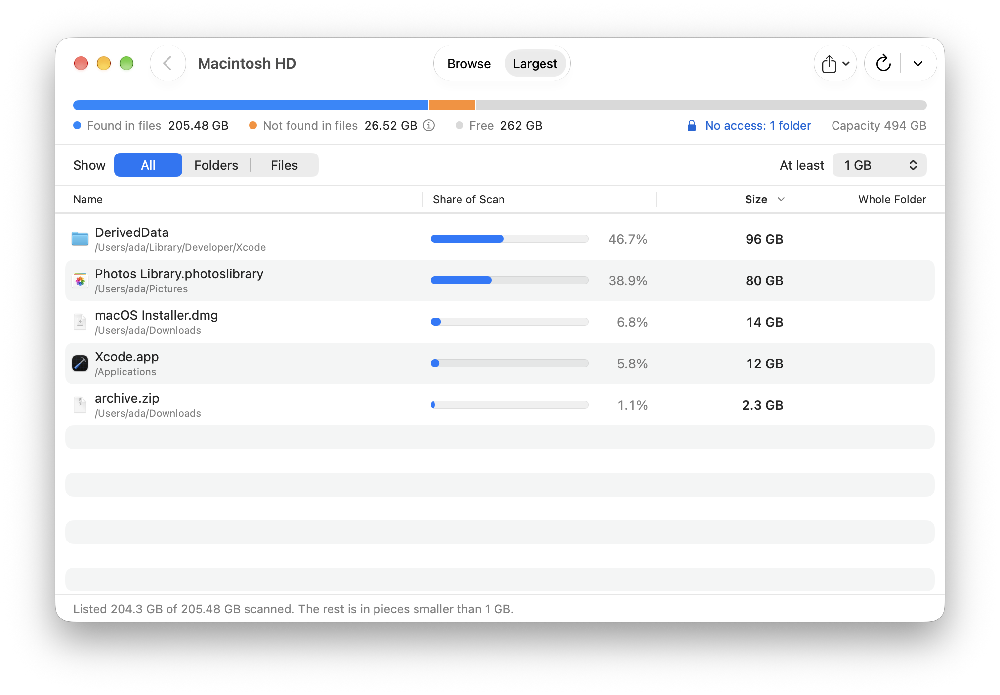

# What Is Taking Up Space

**A macOS disk analyzer that lists what holds your space and leaves out the folders that only wrap it.**

<picture>
  <source media="(prefers-color-scheme: dark)" srcset="docs/largest-dark.png">
  
</picture>

Disk tools show a tree, so you dig. `Documents` is 10 GB. `Work` inside it is 9.6 GB. `Videos` inside that is 9 GB. Two of those three rows told you nothing. The **Largest** view shows `Videos` once and skips its parents.

## What you get

- **Largest.** Files, apps and folders that hold at least the size you pick (100 MB to 10 GB), largest first. A folder is measured without the big things inside it, since those get rows of their own, so rows never overlap.
- **Browse.** A Finder-style list sorted by size, for walking through a folder yourself.
- **Export.** Copy the findings as a Markdown report with full paths, paste it into Claude or another assistant, and ask what a folder is and whether it can go.
- **Disk summary.** How much of the used space the scan found in files, and how much is local snapshots, purgeable data or folders it could not read.
- **Read-only.** The actions are Show in Finder, Quick Look and Copy Path. You do the deleting yourself, in Finder.

## Get it

Runs on macOS 26 or later.

**Download.** Take `WhatIsTakingUpSpace.app.zip` from the [latest release](https://github.com/jmstajim/WhatIsTakingUpSpace/releases/latest), unzip it and move the app to Applications. The build is not notarized, so macOS blocks the first launch: open **System Settings > Privacy & Security**, find the message about the app and click **Open Anyway**.

**Or build it** with Xcode 27:

```bash
git clone https://github.com/jmstajim/WhatIsTakingUpSpace.git
open WhatIsTakingUpSpace/WhatIsTakingUpSpace.xcodeproj
```

In **Signing & Capabilities** choose your team, then press **Run**.

## First scan

1. On the start screen click **Open System Settings…** and turn on Full Disk Access for the app, then reopen it. Until you do, Mail, Messages and other apps' data show as "No access" and are left out of the totals.
2. Click **Scan Macintosh HD**, or **Choose Folder…** for a single folder. Dropping a folder on the window or on the app's icon scans it too.

## Good to know

- Sizes are space taken on disk, as `du` counts it, in Finder's decimal units. A hard-linked file is counted once.
- A scan of the startup disk skips external disks, network volumes and Time Machine snapshots.
- The app never connects to the network. Scan results live in memory and are gone when you quit.
- APFS clones are counted once per copy, so "found in files" can come out above what is really used.
- Folders only root can read show as "No access". The app does not ask for an administrator password.
- The export contains your folder and file names. Read it before you paste it anywhere.

## License

[MIT](LICENSE)
